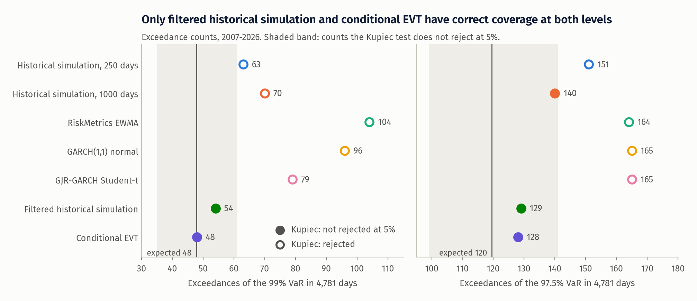
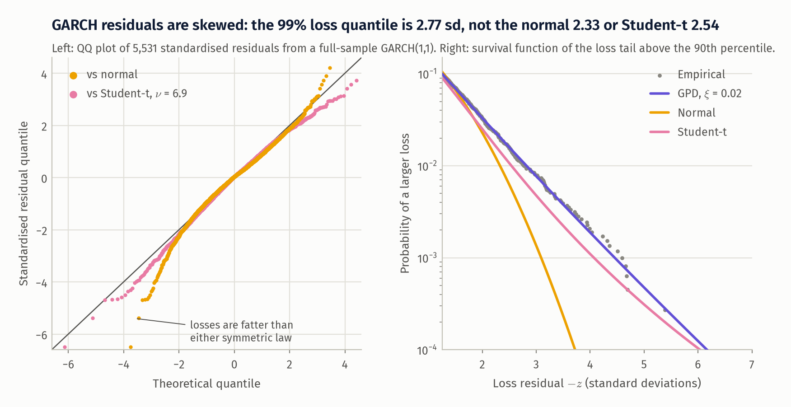
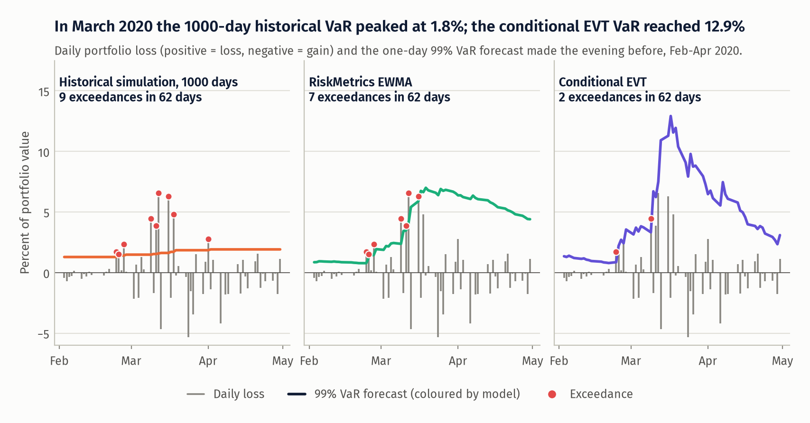
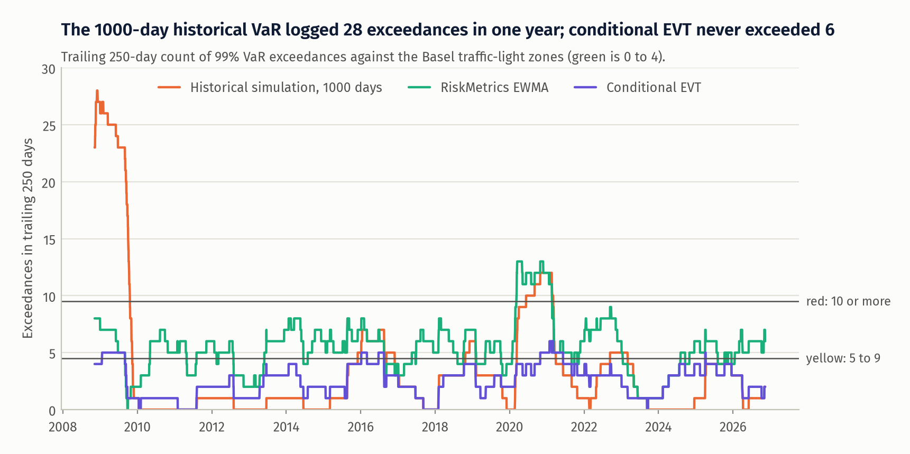
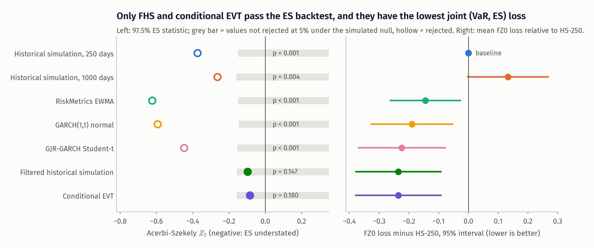
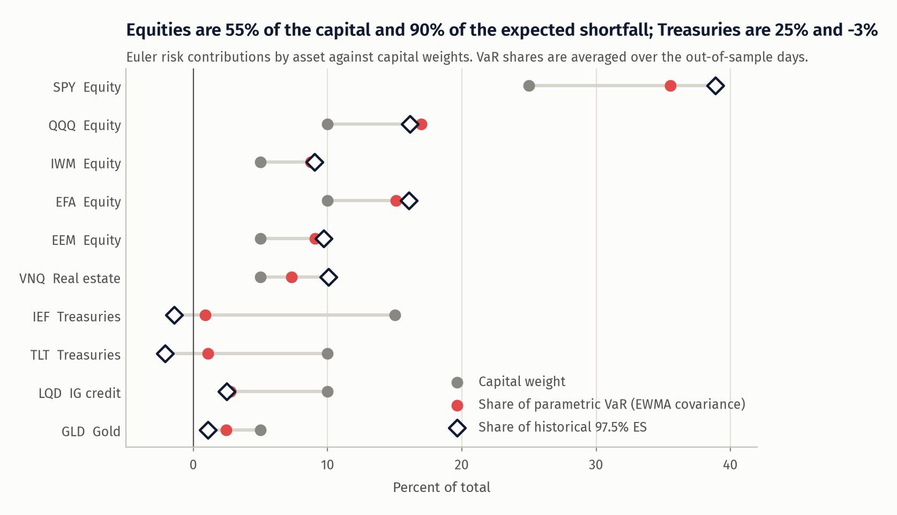

# Backtesting Value-at-Risk and Expected Shortfall for a multi-asset book

I forecast one-day 99% VaR, 97.5% VaR and 97.5% Expected Shortfall for a fixed-weight ten-ETF portfolio on each of 4,781 trading days from 13 Nov 2007 to 13 Nov 2026, using seven models and only data available the evening before, and then test the forecasts the way a risk team or a regulator would. Against 47.8 expected exceedances of the 99% VaR, conditional EVT had 48 and filtered historical simulation 54; the normal models had about double (EWMA 104, GARCH 96), GJR-GARCH with Student-t innovations had 79, and plain historical simulation had 63 (250-day window) and 70 (1000-day window). Only filtered historical simulation and conditional EVT pass the Kupiec test at both levels and both ES backtests (Acerbi-Szekely $Z_2$ p = 0.15 and 0.18); every model, including those two, fails the Christoffersen independence test at 99% at the 5% level except GARCH-normal (p = 0.058), which fails coverage instead. Equities are 55% of the capital and 90% of the historical expected shortfall; Treasuries are 25% of the capital and -3% of it over the full sample, but that sign flipped in 2022.

## The question

A desk needs one number every evening: how much could this book lose tomorrow. The number sets limits and capital, so it has to be right on average (the 99% VaR should be exceeded on 1% of days), right when it matters (exceedances should not arrive in clusters), and honest about the size of the loss when it is exceeded (the ES). The standard candidates differ in two choices: whether they condition on current volatility, and what they assume about the tail of the return distribution. I wanted to know which of those choices matters, by how much, and which model I would run.

## Conventions

- Asset returns are simple daily total returns from adjusted closes, $R_{i,t} = P_{i,t}/P_{i,t-1} - 1$.
- The book is rebalanced to target weights $w$ at every close, so the portfolio return is exactly linear: $r_t = \sum_i w_i R_{i,t}$.
- Loss is positive: $L_t = -r_t$, a fraction of portfolio value. Tables quote percent.
- $\mathrm{VaR}_{a,t}$ is the $a$-quantile of $L_t$ given information at $t-1$; $\mathrm{ES}_{a,t} = \mathbb{E}[L_t \mid L_t \ge \mathrm{VaR}_{a,t}]$. Levels are $a = 0.99$ and $a = 0.975$.
- All models are fitted to the portfolio return series directly. No logs are taken anywhere.

## The mathematics

### One template for seven models

Each model is a predictive distribution of the form $L_t = \ell_t + s_t X$, with $X \sim F$ an innovation law in loss orientation, so that

$$\mathrm{VaR}_{a,t} = \ell_t + s_t\, q_a(F), \qquad \mathrm{ES}_{a,t} = \ell_t + s_t\, \mathrm{ES}_a(F).$$

| Model | $\ell_t$ | $s_t$ | Innovation law $F$ |
|---|---|---|---|
| HS-250, HS-1000 | 0 | 1 | empirical law of the last $n$ losses |
| EWMA (RiskMetrics) | 0 | EWMA $\sigma_t$ | $N(0,1)$ |
| GARCH-N | $-\mu$ | GARCH $\sigma_t$ | $N(0,1)$ |
| GJR-t | $-\mu$ | GJR $\sigma_t$ | Student-t scaled to unit variance |
| FHS | $-\mu$ | GARCH $\sigma_t$ | empirical law of the GARCH residuals $-z$ |
| EVT | $-\mu$ | GARCH $\sigma_t$ | generalised Pareto tail fitted to $-z$ |

GARCH-N, FHS and EVT share one volatility filter, so the comparison among them isolates the innovation distribution.

**Empirical quantile and ES.** For a sorted sample $x_{(1)} \le \dots \le x_{(n)}$ I use the generalised inverse $Q(u) = x_{(\lceil nu \rceil)}$ and the ES of that same distribution,

$$\mathrm{ES}_a = \frac{1}{1-a}\int_a^1 Q(u)\,du = \frac{(\lceil na \rceil - na)\,x_{(\lceil na \rceil)} + \sum_{i > \lceil na \rceil} x_{(i)}}{n(1-a)}.$$

With $n = 250$ the 99% VaR is the third-worst loss and the 97.5% ES averages 6.25 observations.

**EWMA.** $\sigma_t^2 = \lambda \sigma_{t-1}^2 + (1-\lambda) r_{t-1}^2$ with $\lambda = 0.94$, started at $\sigma_1^2 = r_0^2$. Normal quantile $z_a$ and $\mathrm{ES}_a = \varphi(z_a)/(1-a)$.

**GARCH and GJR-GARCH.** With $r_t = \mu + \varepsilon_t$, $\varepsilon_t = \sigma_t z_t$,

$$\sigma_t^2 = \omega + \left(\alpha + \gamma\,\mathbf{1}\{\varepsilon_{t-1} < 0\}\right)\varepsilon_{t-1}^2 + \beta\,\sigma_{t-1}^2 ,$$

where $\gamma = 0$ is GARCH(1,1). The log-likelihoods are

$$\ell_N = -\tfrac12 \sum_t \left[\log 2\pi + \log \sigma_t^2 + \varepsilon_t^2/\sigma_t^2\right],$$

$$\ell_t = \sum_t \left[\log\Gamma\!\left(\tfrac{\nu+1}{2}\right) - \log\Gamma\!\left(\tfrac{\nu}{2}\right) - \tfrac12\log\!\big(\pi(\nu-2)\big) - \tfrac12\log\sigma_t^2 - \tfrac{\nu+1}{2}\log\!\left(1 + \frac{\varepsilon_t^2}{\sigma_t^2(\nu-2)}\right)\right].$$

Constraints: $\omega > 0$, $\alpha \ge 0$, $\alpha + \gamma \ge 0$, $\beta \ge 0$, $\alpha + \gamma/2 + \beta \le 1$, $\nu > 2.05$. Initialisation: pre-sample $\varepsilon^2$ and $\sigma^2$ are set to a backcast $b$, an exponentially weighted mean (decay 0.94) of the first 75 squared deviations from the sample mean, and the pre-sample indicator to 1/2, so $\sigma_0^2 = \omega + (\alpha + \gamma/2 + \beta)\,b$. This is the convention of the `arch` package, which lets me check my estimates against it. The optimiser is SLSQP on percent returns with numerical gradients, started from the best of a five-point grid and from the previous window's estimate. Because the recursion is linear in $\sigma^2$ I evaluate it with `scipy.signal.lfilter`; a fit on 1000 observations takes 10 to 20 ms.

For the unit-variance Student-t, $q_a = \sqrt{(\nu-2)/\nu}\; t_\nu^{-1}(a)$ and

$$\mathrm{ES}_a = \sqrt{\tfrac{\nu-2}{\nu}}\;\frac{f_\nu\!\left(t_\nu^{-1}(a)\right)}{1-a}\;\frac{\nu + t_\nu^{-1}(a)^2}{\nu - 1}.$$

**Conditional EVT (McNeil and Frey 2000).** Let $x = -z$ be the loss residuals of the fitted GARCH, $u$ the $(k+1)$-th largest of $n$, and fit the generalised Pareto distribution $G(y) = 1 - (1 + \xi y/\beta)^{-1/\xi}$ to the $k$ excesses $y = x - u$ by maximum likelihood, minimising $k\log\beta + (1 + 1/\xi)\sum_j \log(1 + \xi y_j/\beta)$. The tail estimator $\bar F(x) = \tfrac{k}{n}\left(1 + \xi\tfrac{x-u}{\beta}\right)^{-1/\xi}$ gives

$$x_q = u + \frac{\beta}{\xi}\left[\left(\frac{(1-q)\,n}{k}\right)^{-\xi} - 1\right], \qquad \mathrm{ES}_q = \frac{x_q}{1-\xi} + \frac{\beta - \xi u}{1-\xi}.$$

I use $k = \lfloor 0.1 n \rfloor$ (100 of 1000), as in the paper. The GPD optimiser is my own (Nelder-Mead on $(\xi, \log\beta)$ from a method-of-moments start) and is checked against `scipy.stats.genpareto.fit`.

### Backtests

Let $I_t = \mathbf{1}\{L_t > \mathrm{VaR}_t\}$, $p = 1-a$, $n$ days, $x = \sum I_t$, $\hat\pi = x/n$.

**Kupiec (1995), unconditional coverage.** $\mathrm{LR}_{uc} = -2\log\dfrac{(1-p)^{n-x}p^x}{(1-\hat\pi)^{n-x}\hat\pi^x} \sim \chi^2_1$.

**Christoffersen (1998), independence and conditional coverage.** With $n_{ij}$ the number of transitions from state $i$ to $j$ of $I_t$, $\pi_{01} = n_{01}/(n_{00}+n_{01})$, $\pi_{11} = n_{11}/(n_{10}+n_{11})$ and $\pi = (n_{01}+n_{11})/(n-1)$,

$$\mathrm{LR}_{ind} = -2\log\frac{(1-\pi)^{n_{00}+n_{10}}\,\pi^{n_{01}+n_{11}}}{(1-\pi_{01})^{n_{00}}\pi_{01}^{n_{01}}(1-\pi_{11})^{n_{10}}\pi_{11}^{n_{11}}} \sim \chi^2_1, \qquad \mathrm{LR}_{cc} = \mathrm{LR}_{uc} + \mathrm{LR}_{ind} \sim \chi^2_2 .$$

**Basel traffic light.** The count of 99% exceedances in the trailing 250 days: green 0 to 4, yellow 5 to 9, red 10 or more.

**Acerbi and Szekely (2014), $Z_2$.** In loss orientation,

$$Z_2 = 1 - \frac{1}{n(1-a)}\sum_t \frac{L_t\,\mathbf{1}\{L_t > \mathrm{VaR}_t\}}{\mathrm{ES}_t}.$$

$\mathbb{E}[Z_2] = 0$ if the forecasts are right and $Z_2 < 0$ if exceedances are too frequent or too large. There is no closed-form null. I simulate it: for each day draw $U_t \sim U(0,1)$ and set the loss to the model's own predictive quantile $Q_t(U_t)$, holding the forecasts fixed, 5,000 times. The p-value is the fraction of simulated $Z_2$ at or below the observed one (one-sided, risk understated).

**McNeil and Frey (2000), exceedance residuals.** On exceedance days $e_t = (L_t - \mathrm{ES}_t)/\mathrm{ES}_t$ has mean zero under the null. I test against $\mathbb{E}[e] > 0$ with the bootstrap t-test of Efron and Tibshirani (10,000 resamples of the centred residuals). McNeil and Frey scale by $\sigma_t$; scaling by the predictable $\mathrm{ES}_t$ is equivalent up to a constant for the location-scale models and also covers historical simulation, which has no $\sigma_t$. This test looks only at the size of exceedances, not their number.

**Scoring.** The pinball loss $a(L-v)^+ + (1-a)(v-L)^+$ is minimised in expectation by the true quantile. The FZ0 loss of Patton, Ziegel and Chen (2019), a member of the Fissler-Ziegel class that is jointly consistent for (VaR, ES), in loss orientation is

$$S(v, e; L) = \frac{\mathbf{1}\{L > v\}(L - v)}{(1-a)\,e} + \frac{v}{e} + \log e - 1 .$$

For two models with loss differential $d_t$, the Diebold-Mariano statistic $\bar d / \sqrt{\widehat{\mathrm{LRV}}/n} \sim N(0,1)$ uses a Newey-West variance with $\lfloor n^{1/3} \rfloor$ lags.

### Euler decomposition

A risk measure $\rho(w)$ that is homogeneous of degree one satisfies $\rho(w) = \sum_i w_i\,\partial\rho/\partial w_i$. Under a zero-mean elliptical model with covariance $\Sigma$, VaR and ES are both multiples of $\sigma_p = \sqrt{w'\Sigma w}$, so both have shares $w_i(\Sigma w)_i / w'\Sigma w$. For historical ES, $\partial \mathrm{ES}/\partial w_i = \mathbb{E}[-R_i \mid L \ge \mathrm{VaR}]$, so the contribution of asset $i$ is the average of its own loss $-w_i R_{i,t}$ over the portfolio's tail days.

## Method

**Data.** Adjusted daily closes from Yahoo Finance for ten ETFs, cached on first download. The first date with all ten is 18 Nov 2004 (GLD's first day), giving 5,531 returns to 13 Nov 2026.

| | SPY | QQQ | IWM | EFA | EEM | VNQ | IEF | TLT | LQD | GLD |
|---|---|---|---|---|---|---|---|---|---|---|
| Weight (%) | 25 | 10 | 5 | 10 | 5 | 5 | 15 | 10 | 10 | 5 |

That is 55% equity, 5% real estate, 35% bonds and 5% gold. Over the sample the book returned 8.9% a year with 12.0% volatility; its worst day was -6.57% on 12 Mar 2020.

**Forecast design, fixed before running anything.** Each forecast uses the most recent 1000 trading days, or everything since November 2004 while fewer exist: the first forecast (13 Nov 2007) uses 750 days and the window reaches 1000 in November 2008. I accepted that shorter first year so that the 2008 crisis would be in the test rather than only in the estimation sample. GARCH and GPD parameters are re-estimated every 20 days (240 times); in between, the variance is updated daily with the fixed parameters. $\lambda = 0.94$, the 1000-day window and the 10% tail fraction are the values in RiskMetrics and McNeil-Frey. Nothing was tuned on the results. Seed 2026 for the simulated and bootstrap p-values.

**Verification.** 45 tests. My GARCH, GJR, GARCH-t and GJR-t estimates match `arch` on three real windows and on simulated data: log-likelihood within $10^{-6}$, parameters within a relative $5\times10^{-4}$ (in practice the fifth or sixth significant figure). The GPD tail formulas are exact for a Pareto distribution, for which the excess distribution is exactly GPD, and the fit matches SciPy. Kupiec and Christoffersen statistics match hand calculations. Under a true model the Kupiec, conditional-coverage, $Z_2$, McNeil-Frey and Diebold-Mariano tests reject close to 5% of the time; the independence test rejects only 1.6% of the time at 97.5% with 1,500 observations, so it is conservative. Euler contributions sum to the total and equal a finite-difference derivative. Corrupting the data from day $t$ onwards leaves every forecast up to day $t$ bit-for-bit unchanged.

## Results

### Coverage



**Table 1. VaR coverage, 4,781 out-of-sample days**

| Model | 99% exc. (exp. 47.8) | Kupiec p | Indep. p | Cond. cov. p | 97.5% exc. (exp. 119.5) | Kupiec p | Cond. cov. p |
|---|---|---|---|---|---|---|---|
| HS-250 | 63 | 0.035 | <0.001 | <0.001 | 151 | 0.005 | <0.001 |
| HS-1000 | 70 | 0.003 | <0.001 | <0.001 | 140 | 0.065 | <0.001 |
| EWMA | 104 | <0.001 | 0.009 | <0.001 | 164 | <0.001 | <0.001 |
| GARCH-N | 96 | <0.001 | 0.058 | <0.001 | 165 | <0.001 | <0.001 |
| GJR-t | 79 | <0.001 | 0.011 | <0.001 | 165 | <0.001 | <0.001 |
| FHS | 54 | 0.378 | 0.003 | 0.009 | 129 | 0.386 | 0.504 |
| EVT | 48 | 0.978 | 0.001 | 0.005 | 128 | 0.438 | 0.529 |

Three things stand out. First, the normal quantile is wrong by a factor of two at 99% whatever the volatility model. Second, the Student-t does not fix it. Third, FHS and EVT have the right number of exceedances, but at 99% they still fail independence: an exceedance was followed by another the next day 7.4% (FHS) and 8.3% (EVT) of the time against about 1% otherwise. With roughly 50 exceedances that is four consecutive pairs, so the evidence rests on a handful of days, but it is a rejection and I report it as one. At 97.5% both pass conditional coverage.



The reason the Student-t fails is skewness. Standardised residuals from a full-sample GARCH(1,1) have skewness -0.42 and excess kurtosis 1.67. Their 99% loss quantile is 2.77 standard deviations; the normal says 2.33 and the fitted symmetric t ($\nu = 6.9$) says 2.54, while the 99% quantile on the gain side is only 2.21, below the normal. A symmetric fat-tailed law splits the excess kurtosis evenly between two tails when it belongs almost entirely to one. The GPD is fitted to the loss tail alone and gives 2.82. In the rolling GJR-t fits the median $\alpha$ is zero and the median $\gamma$ is 0.16, so the variance responds only to negative returns, and the median $\nu$ is 7.7; the asymmetry in volatility dynamics does not remove the asymmetry in the residuals. The rolling GPD shape has median $\xi = 0.02$ (range -0.22 to 0.19): once volatility is filtered out the loss tail is close to exponential, heavier than normal but far from a power law.

### When the failures happen



**Table 4. 99% VaR exceedances by sub-period (Kupiec p in brackets)**

| Period | Days | Expected | HS-250 | HS-1000 | EWMA | GARCH-N | GJR-t | FHS | EVT |
|---|---|---|---|---|---|---|---|---|---|
| 2007-11 to 2009-12 | 538 | 5.4 | 14 (0.002) | 29 (<0.001) | 10 (0.074) | 12 (0.014) | 9 (0.153) | 10 (0.074) | 5 (0.868) |
| 2010 to 2019 | 2516 | 25.2 | 25 (0.974) | 17 (0.082) | 53 (<0.001) | 47 (<0.001) | 39 (0.010) | 26 (0.867) | 22 (0.518) |
| 2020 to 2026-11 | 1727 | 17.3 | 24 (0.124) | 24 (0.124) | 41 (<0.001) | 37 (<0.001) | 31 (0.003) | 18 (0.861) | 21 (0.383) |
| full 1000-day windows only | 4531 | 45.3 | 50 (0.491) | 47 (0.802) | 96 (<0.001) | 87 (<0.001) | 73 (<0.001) | 45 (0.963) | 44 (0.844) |

Historical simulation and the normal models fail in opposite ways. Historical simulation has roughly the right count in calm decades and fails in crises: 29 exceedances against 5.4 expected through 2009 for the 1000-day window, and in March 2020 its VaR moved from 1.28% to a peak of 1.84% while the book lost up to 6.57% in a day. The normal models react quickly but are too low all the time, including the quiet 2010s. The last row drops the first year, when windows were shorter than 1000 days: historical simulation then passes Kupiec (p = 0.49 and 0.80), so its unconditional failure in Table 1 comes from 2008. Its independence failure does not go away.



**Table 3. Level and stability of the 99% VaR, and Basel zones**

| Model | Mean VaR (%) | Max VaR (%) | Max / median | Mean abs. daily change (%) | Green (%) | Yellow (%) | Red (%) | Max 250-day count |
|---|---|---|---|---|---|---|---|---|
| HS-250 | 2.04 | 5.35 | 3.3 | 0.31 | 72.1 | 23.2 | 4.7 | 14 |
| HS-1000 | 2.03 | 3.25 | 1.7 | 0.09 | 79.1 | 11.7 | 9.3 | 28 |
| EWMA | 1.56 | 7.98 | 6.1 | 3.26 | 30.3 | 64.4 | 5.3 | 13 |
| GARCH-N | 1.51 | 10.35 | 8.0 | 5.92 | 45.0 | 53.7 | 1.3 | 10 |
| GJR-t | 1.63 | 11.41 | 8.3 | 5.96 | 57.9 | 42.1 | 0.0 | 8 |
| FHS | 1.79 | 12.62 | 8.3 | 5.89 | 88.9 | 11.1 | 0.0 | 9 |
| EVT | 1.82 | 12.92 | 8.4 | 5.88 | 91.5 | 8.5 | 0.0 | 6 |

EVT is in the green zone on 91.5% of days and never in the red; HS-1000 spent 9.3% of days in the red and EWMA 64.4% in the yellow. Conditional EVT also holds less capital on average than historical simulation (mean VaR 1.82% against 2.03%) while covering better, because it holds it at the right times. The price is in the fourth and fifth columns: the GARCH-based VaR peaks at more than eight times its median and moves by 5.9% of its own level on an average day, against 0.09% for HS-1000.

### Expected Shortfall and scores



**Table 2. 97.5% ES backtests and scoring**

| Model | Z2 | Z2 p | Mean exceedance residual | McNeil-Frey p | Pinball 99% (bp) | FZ0 | DM vs HS-250 (FZ0) |
|---|---|---|---|---|---|---|---|
| HS-250 | -0.374 | <0.001 | +0.087 | 0.004 | 3.134 | -3.8250 | baseline |
| HS-1000 | -0.265 | 0.004 | +0.080 | 0.026 | 3.407 | -3.6921 | 1.91 |
| EWMA | -0.624 | <0.001 | +0.184 | <0.001 | 2.553 | -3.9697 | -2.41 |
| GARCH-N | -0.595 | <0.001 | +0.155 | <0.001 | 2.430 | -4.0148 | -2.72 |
| GJR-t | -0.448 | <0.001 | +0.049 | 0.010 | 2.292 | -4.0489 | -3.01 |
| FHS | -0.098 | 0.147 | +0.017 | 0.216 | 2.337 | -4.0602 | -3.22 |
| EVT | -0.086 | 0.180 | +0.014 | 0.264 | 2.333 | -4.0608 | -3.22 |

Both ES tests accept FHS and EVT and reject the other five. The mean exceedance residual says how much larger than the ES forecast the average exceedance was: 18% for EWMA, about 1.5% for FHS and EVT. On the scoring rules every conditional model beats 250-day historical simulation significantly, including the normal ones that fail every coverage test, because a scoring rule rewards tracking volatility even when the level is biased. The ranking at the top is not statistically resolved: the Diebold-Mariano statistic for EVT against GJR-t on FZ0 is -0.69 and for EVT against FHS -0.34, and GJR-t has the lowest 99% pinball loss. What separates FHS and EVT from GJR-t is calibration, not sharpness.

### Risk decomposition



**Table 6. Euler risk contributions against capital weights (percent of total)**

| Asset | Class | Capital weight | Parametric VaR share | Historical 97.5% ES share |
|---|---|---|---|---|
| SPY | Equity | 25 | 35.5 | 38.9 |
| QQQ | Equity | 10 | 17.0 | 16.1 |
| IWM | Equity | 5 | 8.8 | 9.0 |
| EFA | Equity | 10 | 15.1 | 16.0 |
| EEM | Equity | 5 | 9.1 | 9.7 |
| VNQ | Real estate | 5 | 7.3 | 10.1 |
| IEF | Treasuries | 15 | 0.9 | -1.4 |
| TLT | Treasuries | 10 | 1.1 | -2.1 |
| LQD | IG credit | 10 | 2.8 | 2.5 |
| GLD | Gold | 5 | 2.5 | 1.1 |
| **Equity** | | **55** | **85.5** | **89.8** |
| **Gold** | | **5** | **2.5** | **1.1** |
| **IG credit** | | **10** | **2.8** | **2.5** |
| **Real estate** | | **5** | **7.3** | **10.1** |
| **Treasuries** | | **25** | **2.0** | **-3.5** |

The VaR share uses the EWMA covariance and is averaged over the out-of-sample days; the ES share is the historical contribution over the whole sample. Equity and real estate are 60% of the capital and all of the tail risk. Real estate is worse in the tail (10.1%) than its volatility share suggests (7.3%). The full-sample Treasury number hides a regime change: the Treasury sleeve's EWMA risk share averaged -1.1% through 2021 and was negative on 62% of days, then averaged +11.0% from 2022 and was negative on 3% of days. Its historical ES share was -6.0% before 2022 and +6.0% after. A 60/40-style book lost its hedge in 2022 and has not got it back.

### Stress windows

**Table 5. Stress windows: book P&L and 99% VaR behaviour**

| Window | Return (%) | Max drawdown (%) | Worst day (%) | Days | Model | Exceedances | VaR at start (%) | Peak VaR (%) | Days to double |
|---|---|---|---|---|---|---|---|---|---|
| GFC, Sep-Nov 2008 | -19.6 | -28.5 | -6.04 | 63 | HS-250 | 11 | 1.53 | 4.26 | 32 |
| | | | | | HS-1000 | 21 | 1.46 | 3.11 | 54 |
| | | | | | EWMA | 5 | 1.55 | 7.98 | 14 |
| | | | | | GARCH-N | 5 | 1.46 | 8.19 | 20 |
| | | | | | GJR-t | 2 | 1.59 | 8.15 | 12 |
| | | | | | FHS | 5 | 1.56 | 9.04 | 19 |
| | | | | | EVT | 4 | 1.68 | 9.76 | 19 |
| COVID, 19 Feb-31 Mar 2020 | -12.2 | -20.6 | -6.57 | 30 | HS-250 | 8 | 1.28 | 4.81 | 17 |
| | | | | | HS-1000 | 8 | 1.28 | 1.84 | never |
| | | | | | EWMA | 7 | 0.81 | 6.99 | 7 |
| | | | | | GARCH-N | 4 | 0.68 | 10.35 | 4 |
| | | | | | GJR-t | 3 | 0.77 | 11.41 | 4 |
| | | | | | FHS | 2 | 0.84 | 12.62 | 4 |
| | | | | | EVT | 2 | 0.84 | 12.92 | 4 |
| Rates sell-off, Jan-Oct 2022 | -21.6 | -24.6 | -3.35 | 209 | HS-250 | 5 | 1.59 | 2.72 | never |
| | | | | | HS-1000 | 5 | 2.12 | 2.35 | never |
| | | | | | EWMA | 6 | 1.24 | 3.18 | 85 |
| | | | | | GARCH-N | 6 | 1.06 | 3.97 | 23 |
| | | | | | GJR-t | 4 | 1.10 | 4.72 | 11 |
| | | | | | FHS | 2 | 1.32 | 5.37 | 23 |
| | | | | | EVT | 3 | 1.40 | 5.14 | 23 |
| Tariff shock, Apr 2025 | 0.2 | -8.3 | -3.44 | 20 | HS-250 | 3 | 1.53 | 2.41 | never |
| | | | | | HS-1000 | 3 | 1.82 | 1.93 | never |
| | | | | | EWMA | 2 | 1.39 | 4.46 | 6 |
| | | | | | GARCH-N | 2 | 1.42 | 4.96 | 6 |
| | | | | | GJR-t | 2 | 1.59 | 4.02 | 7 |
| | | | | | FHS | 2 | 1.69 | 5.83 | 6 |
| | | | | | EVT | 2 | 1.59 | 5.66 | 6 |

"Days to double" is the number of trading days from the start of the window until the model's VaR first reached twice its starting level. No model had zero exceedances in any window: a one-day VaR conditioned on yesterday cannot anticipate the first shock, and the best ones still took two exceedances in March 2020 where 0.3 were expected. The difference is what happens next. Going into COVID the conditional models held the least capital of all (GARCH-N 0.68%, EVT 0.84%, against 1.28% for historical simulation) because 2019 had been calm, then doubled within four days. 2022 was a different kind of event: a 21.6% loss with no day worse than 3.35%, with Treasuries (IEF -16.9%, TLT -34.1%) falling alongside equities. A one-day VaR sees little of that; it is a drawdown and correlation problem, which is why the decomposition above matters more than the VaR count for that year.

## What I would run

Conditional EVT, with filtered historical simulation as the challenger model. They share a filter, they are statistically indistinguishable on every score here, and they are the only two that get the 99% count, the 97.5% count and the ES right. I prefer EVT for a linear book because the fitted tail gives a smooth 99% quantile and a defensible ES from 100 tail observations, where FHS at 97.5% averages 25. For a book with options I would switch the order: FHS produces whole scenarios that can be repriced, and EVT on the portfolio P&L cannot.

I would not use that number raw for capital. A VaR that moves 5.9% a day and peaked at 8.4 times its median is right as a measurement and bad as a capital requirement: it asks for the most capital after the losses have happened and the least before them, as February 2020 shows. So I would run two numbers. The conditional EVT VaR and ES drive daily limits and escalation, where reacting within four days is the point. Capital is set from a slower transformation of it, such as the larger of yesterday's value and a multiple of its 60-day average, with a floor from a stressed calibration window that includes 2008 and March 2020. That keeps the fast model's information and removes most of the procyclicality. I would keep HS-1000 on the dashboard only as that kind of slow reference, never as the risk number: it had 21 exceedances in the 63 days from September 2008.

I would also treat the independence rejection as an open item. Back-to-back exceedances mean a single day's shock is not fully absorbed into the next day's variance by a GARCH(1,1) with one news coefficient.

## What this does not show

- **One portfolio, one history.** The results are for a long-only, linear, equity-dominated book. Skewed residuals are what broke the Student-t; a book with different skew could rank the models differently.
- **The universe was chosen with hindsight.** These ten ETFs all survived to 2026. I dropped HYG and DBC, which a fuller multi-asset book would hold, because they start in 2007 and 2006 and would have pushed the first forecast past the 2008 crisis.
- **The first year uses shorter windows** (750 to 1000 days), and HS-1000's headline failure comes largely from that year (Table 4, last row).
- **Portfolio-level models.** Fitting the portfolio return series assumes fixed weights and says nothing about how risk changes when positions change. A production system needs a multivariate model or full revaluation.
- **One-day horizon.** No 10-day VaR, no liquidity horizons, no square-root-of-time scaling, which would be wrong under GARCH anyway.
- **p-values ignore estimation error.** The $Z_2$ simulation treats each day's fitted predictive distribution as known, and the coverage tests assume the hit sequence is the only source of randomness. With seven models and about ten tests each, some rejections at 5% would occur by chance; the ones I rely on are far from the threshold.
- **The independence test is first-order and conservative** (1.6% rejections under the null in my Monte Carlo at 97.5%). It cannot see clustering at longer lags; a duration-based or dynamic-quantile test would.
- **Data.** Yahoo adjusted closes are a total-return proxy that I did not reconcile against a second source. Closing prices of bond and international ETFs can be stale relative to the US equity close.
- **Daily rebalancing is free here.** That is irrelevant to the risk measure but the 8.9% return is not a tradable track record.

## What I would do next

- Replace the symmetric t with a skewed t (Hansen 1994) and see whether a parametric model can match FHS and EVT.
- Use the GJR filter under FHS and EVT, and add the Engle-Manganelli dynamic quantile test, to chase the back-to-back exceedances.
- Multivariate version: DCC or a factor covariance with FHS on the residual vector, so the decomposition and the backtest come from one model.
- Backtest the capital rule itself: the smoothed, floored number against 10-day losses.
- Model-confidence-set comparison in place of pairwise Diebold-Mariano tests.

## Reproduce

```bash
pip install -r requirements.txt
pip install -e .
python scripts/01_download_data.py          # caches data/prices.csv
python scripts/02_forecast_and_backtest.py  # about 30 s; writes results/summary.json, results/web/var_series.json
python scripts/03_decompose_and_stress.py   # adds decomposition, stress, diagnostics; results/web/risk_contrib.json
python scripts/04_make_figures.py
python scripts/05_readme_tables.py          # results/tables.md, the tables above
pytest                                      # 45 tests, about 20 s
```

Every result quoted in this README is in `results/summary.json`; the only exceptions are the test-suite tolerances and rejection rates in the verification paragraph, which come from `tests/`. Results depend on the Yahoo data vintage; `data/` is not committed.

## References

- Acerbi, C. and Szekely, B. (2014). Back-testing expected shortfall. *Risk*, December.
- Barone-Adesi, G., Giannopoulos, K. and Vosper, L. (1999). VaR without correlations for portfolios of derivative securities. *Journal of Futures Markets* 19(5).
- Basel Committee on Banking Supervision (1996). *Supervisory framework for the use of "backtesting" in conjunction with the internal models approach to market risk capital requirements.*
- Bollerslev, T. (1986). Generalized autoregressive conditional heteroskedasticity. *Journal of Econometrics* 31(3).
- Bollerslev, T. (1987). A conditionally heteroskedastic time series model for speculative prices and rates of return. *Review of Economics and Statistics* 69(3).
- Christoffersen, P. (1998). Evaluating interval forecasts. *International Economic Review* 39(4).
- Diebold, F. and Mariano, R. (1995). Comparing predictive accuracy. *Journal of Business and Economic Statistics* 13(3).
- Efron, B. and Tibshirani, R. (1993). *An Introduction to the Bootstrap.* Chapman and Hall.
- Fissler, T. and Ziegel, J. (2016). Higher order elicitability and Osband's principle. *Annals of Statistics* 44(4).
- Glosten, L., Jagannathan, R. and Runkle, D. (1993). On the relation between the expected value and the volatility of the nominal excess return on stocks. *Journal of Finance* 48(5).
- Hansen, B. (1994). Autoregressive conditional density estimation. *International Economic Review* 35(3).
- J.P. Morgan/Reuters (1996). *RiskMetrics Technical Document*, 4th edition.
- Kupiec, P. (1995). Techniques for verifying the accuracy of risk measurement models. *Journal of Derivatives* 3(2).
- McNeil, A. and Frey, R. (2000). Estimation of tail-related risk measures for heteroscedastic financial time series: an extreme value approach. *Journal of Empirical Finance* 7(3-4).
- Patton, A., Ziegel, J. and Chen, R. (2019). Dynamic semiparametric models for expected shortfall (and value-at-risk). *Journal of Econometrics* 211(2).
- Tasche, D. (1999). Risk contributions and performance measurement. Working paper, Technische Universität München.
